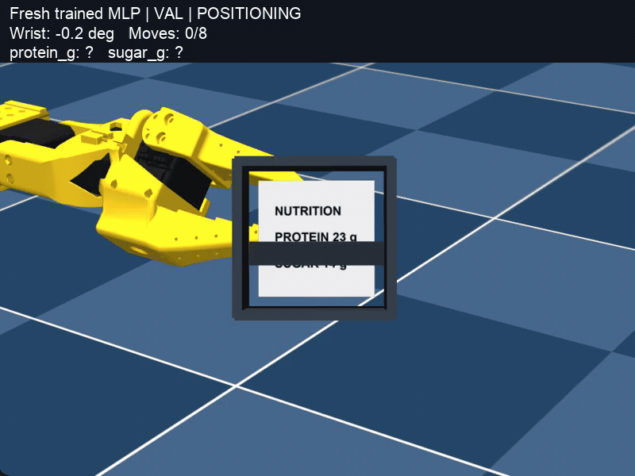

# SO-101: 읽기 쉬운 방향 정책 학습 실험

가려진 영양성분을 읽기 위해 손목을 좌우 5°씩 움직입니다. OCR로 읽은 정보를 기억하고, 작은 MLP가 다음 방향을 선택합니다. 두 값이 모두 확인되면 기억 규칙이 STOP을 결정합니다.



## 실행

**Conda `so101` 환경, Python 3.12.0**에서 실행한 실험입니다. 학습 데이터와 원본 관측 이미지는 저장소에 포함되어 있습니다.

```bash
conda activate so101
./run_experiment.sh
```

스크립트 하나로 다음을 실행합니다.

1. 압축된 원본 관측 이미지·로봇 mesh·합성 라벨을 풀고, 없으면 OCR 가중치를 다운로드합니다.
2. 에피소드와 관측표에서 방향 교사 정답과 77차원 학습 입력을 만듭니다.
3. 새로 초기화한 모델을 학습하고, val 손실이 가장 작은 가중치를 저장합니다.
4. val/test 장면에서 모델과 비교 규칙을 실제 MuJoCo 이동·새 촬영·새 OCR로 평가합니다.
5. 새 체크포인트로 val 시연 GIF를 만듭니다.

재실행하면 `results/`의 파일을 덮어씁니다. 해시 검사나 수정 잠금은 없습니다. 일반 macOS 터미널에서 실행하세요. `invalid CoreGraphics connection`은 해당 실행 환경의 그래픽 접근 문제입니다.

처음 환경을 만드는 경우 먼저 실행합니다. 기존 `so101` 환경이 있으면 생략합니다.

```bash
conda create -n so101 python=3.12
conda activate so101
python -m pip install -r requirements.txt
```

스크립트는 활성화한 환경의 `python`을 사용합니다. `PYTHON=/path/to/python ./run_experiment.sh`로 직접 지정할 수도 있습니다. 첫 실행의 OCR 가중치 다운로드에는 인터넷이 필요합니다.

빠른 관측표 재생 평가도 가능합니다.

```bash
python evaluate.py --mode replay
```

이 명령은 CSV 평가 결과를 덮어씁니다. `replay`는 저장된 OCR 관측표를 사용하며, 기본 실행의 `live` 평가와 구분해야 합니다. 다시 `./run_experiment.sh`를 실행하면 새 live 결과가 생성됩니다.

## 파일 구조와 읽는 순서

```text
so101-simple/
  dataset.py                 # 데이터 읽기, 77차원 입력 구성
  model.py                   # 77 -> 32 -> 2 MLP와 행동 선택
  train.py                   # 학습, val 선택, best_model.pt 저장
  evaluate.py                # 분류·온라인 평가, CSV 표 저장
  demo.py                    # 새 체크포인트로 시연 GIF 생성
  config.json                # seed, 학습률, epoch 등 수정할 설정
  requirements.txt           # 실제 so101 환경의 pip freeze 목록
  run_experiment.sh          # 전체 실험 실행
  data/
    images/                  # 원본 PNG 압축 묶음; 실행 시 이곳에 자동 해제
    train/episode_*.json      # train 에피소드
    val/episode_*.json        # val 에피소드
    test/episode_*.json       # test 에피소드
    train/samples.jsonl       # train의 가공된 모델 입력·교사 정답
    val/samples.jsonl
    test/samples.jsonl
    scenes.json              # 장면 설정, 정답, 각도별 OCR 관측표
    source.json              # 원자료 위치와 이미지 공유 통계
    summary.json             # 입력 수와 제외 사유
  simulation/
    environment.py           # 로봇 이동 -> 렌더링 -> OCR
    memory.py                # OCR 파싱, 누적 기억, 충돌 재확인
    geometry.py              # 화면 범위·침투·접촉 검사
    assets/                  # 기준 XML, 라벨·mesh·OCR 가중치
  scripts/
    import_data.py           # 다른 원자료를 위 data 구조로 가져오기
    setup_assets.py          # mesh·라벨 압축 해제와 OCR 가중치 준비
    prepare_data.py          # BFS 교사 정답 생성
  results/                   # 모델별 중첩 폴더 없이 결과 파일로 모음
  tests/test_pipeline.py     # 인과 입력·기억·교사·종료 동작 테스트
```

처음 읽는다면 **`evaluate.py:run_episode()` → `dataset.py:encode_history()` → `model.py` → `train.py` → `scripts/prepare_data.py`** 순서가 좋습니다. 물리 이동이 궁금할 때 `simulation/environment.py`로 내려갑니다.

## 데이터의 의미

기존 로컬 SO-101 수집 실험의 원자료를 사용합니다. 관측표와 수집 에피소드를 새로 촬영한 실험은 아닙니다. 이번 작업에서는 원자료를 정리하고, 교사 정답을 다시 구성하고, 모델을 새로 학습하고, 온라인 평가와 데모를 새로 실행합니다.

원자료는 15개 장면, 345개 각도 관측, 60개 에피소드입니다. train/val/test는 라벨 단위로 12/2/1개 장면이며, 에피소드는 48/8/4개입니다. 재라벨·중복 상태 병합 후 학습 입력은 81/14/5개입니다.

한 에피소드는 **동일 장면에서 손목각을 바꾸며 관측한 순서**입니다. `data/train/episode_000005.json` 같은 파일의 `observations` 배열에서 시간 순서를 읽습니다.

```json
{
  "episode_id": "example",
  "scene_id": "scene_000001",
  "observations": [
    {"step": 0, "image": "data/images/frame_000001.png", "wrist_deg": 0, "action": "RIGHT_5"},
    {"step": 1, "image": "data/images/frame_000002.png", "wrist_deg": 5, "action": "STOP"}
  ]
}
```

위 JSON은 구조를 설명하는 예시입니다. 실제 파일에는 OCR, 누적 기억, 관절 상태와 도착 시 이동 정보도 있습니다. 경로는 프로젝트 루트 기준입니다. `action`은 해당 관측 뒤에 선택한 행동이고, 예산 소진 등의 무행동 종료는 `null`입니다.

이미지 참조 718개를 356개 원본 PNG로 공유해 약 90.6MB에서 44.6MB로 줄였습니다. 바이트가 완전히 같은 이미지 파일만 공유합니다. **관측 단계와 관측 ID는 별도로 유지**하므로 같은 경로를 참조해도 시간·기억 기록이 합쳐지지 않습니다. 원본 이미지를 보존하고 재생성 가능한 224×224 파생 이미지는 제외했습니다.

`data/scenes.json`의 실제 정답·미래 관측표는 교사 생성과 사후 평가에 사용합니다. `dataset.py`가 모델에 제공하는 입력에는 이미지, OCR 숫자값, 실제 정답, 미래 관측, 장면 ID, 수집 전략이 없습니다.

## 학습과 결과

고정 seed는 `config.json`에서 바꿉니다. 77차원 상태에서 LEFT_5/RIGHT_5를 예측하는 지도학습입니다. STOP과 관절 위치 제어는 학습 대상이 아닙니다. 정규화 통계는 train에서 계산하고, 최적 epoch는 val 손실로 선택합니다. `train.py`는 test를 읽지 않습니다.

| 결과 파일 | 내용 |
|---|---|
| `results/best_model.pt` | 선택한 새 모델의 가중치·정규화 통계·학습 설정 |
| `results/training.csv` | epoch별 train/val 손실·val 정확도 |
| `results/training_summary.json` | 선택 epoch, 파라미터 수, 학습 시간 |
| `results/classification.csv` | train/val/test 방향 분류와 항상 오른쪽 규칙 비교 |
| `results/metrics.csv` | val/test의 정책별 성공률·이동량·잘못된 STOP·기술 오류 |
| `results/episodes.csv` | 개별 평가 에피소드의 결과 |
| `results/evaluation.jsonl` | 새 온라인 평가의 전체 관측·행동 기록 |
| `results/report.md` | 결과 표와 해석 범위 |
| `results/demo.gif`, `results/demo.json` | 새 모델의 val 시연과 상세 기록 |

기존에 개발에 사용한 라벨이며 test가 한 장면뿐입니다. val/test 교사 방향도 모두 오른쪽입니다. 정확도 100% 또는 test 성공 1/1을 새로운 라벨 일반화나 규칙 대비 우위로 해석하면 안 됩니다. 자세한 실제 결과는 [실험 보고서](results/report.md)를 참고하세요.

## 환경과 로컬 자산

`requirements.txt`는 실험에 사용한 `so101` 환경에서 `python -m pip freeze`로 추출한 46개 패키지 목록입니다. 같은 Python 3.12 환경에 설치할 때 사용할 수 있습니다. 이번 작업에서는 기존 환경을 그대로 사용했고, 별도 새 환경에 대한 재설치는 하지 않았습니다.

기준 XML, 정확히 사용한 로봇 mesh의 `meshes.zip`, 합성 라벨 15장의 `labels.zip`을 포함했습니다. 실행 스크립트가 자동으로 압축을 풉니다. 약 94MB의 EasyOCR 가중치는 Git에 포함하지 않고 첫 실행 때 내려받습니다. 이전 프로젝트의 Python 코드나 개인 컴퓨터 경로는 필요하지 않습니다.

에피소드가 참조하는 원본 PNG 356장은 `data/images/images_01.zip`부터 `images_08.zip`까지 작은 압축 묶음으로 모두 포함했습니다. GitHub API의 단일 전송 크기 제한 때문에 나누었으며, 처음 실행하면 동일한 `data/images/` 폴더에 원본 PNG가 자동으로 풀립니다. [이미지 안내](data/images/README.md)를 참고하세요. 이미지 공유 후 원자료 이미지 용량은 약 44.6MB이고 전체 공개 파일은 약 58MB 규모입니다.

이미 포함된 데이터를 쓸 때 원자료 가져오기는 필요하지 않습니다. 다른 로컬 수집 데이터를 정리하려면 `python scripts/import_data.py --source /path/to/original/data`를 사용합니다. 이 명령은 데이터 파일을 다시 만듭니다.

로봇 모델 출처는 TheRobotStudio/SO-ARM100이며 기준 XML에 라벨·hood·가림판·카메라를 추가한 수정본입니다. Apache 2.0 라이선스는 `simulation/assets/ROBOT_LICENSE.txt`에 포함했습니다.

```bash
python -m unittest discover -s tests -v
```
