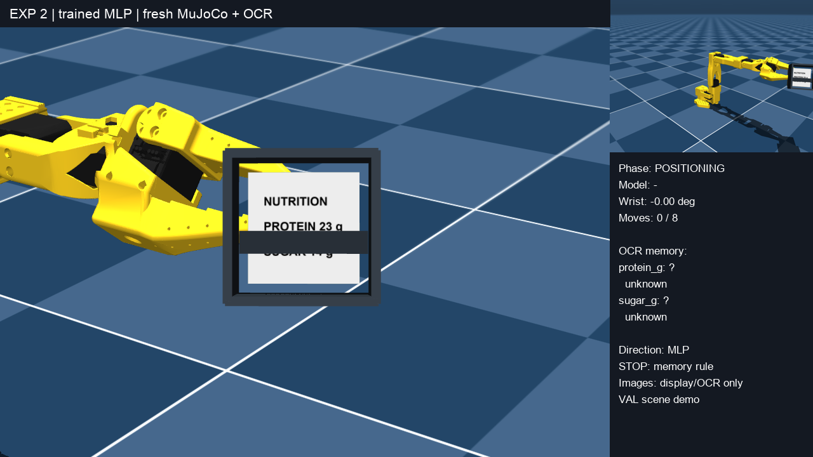
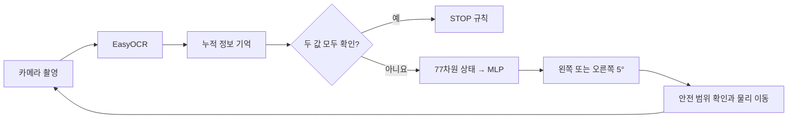

# SO-101 Active Label Reading

**가려진 영양성분을 읽기 위해 로봇의 다음 시점을 고르는 토이 프로젝트.**

MuJoCo의 SO-101 로봇 손목을 5°씩 움직여, 서로 다른 시점에서 읽은 **단백질·당류 정보를 OCR 기억에 누적**합니다. 두 값을 모두 확인하면 멈추며, 최대 이동 예산은 8회입니다. 데이터 수집부터 최단 경로 교사 라벨, 작은 MLP 학습, 실제 시뮬레이션 이동과 새 OCR을 이용한 비교 평가까지 구현했습니다.

[](docs/media/policy-motion.mp4)

▶ **[데모 영상 보기 · MP4, 15.25초, 약 0.50MB](https://github.com/douyoung89/so101-toy-proj/raw/refs/heads/main/docs/media/policy-motion.mp4)** · [종료 화면](docs/media/last-frame.png) · [관측·행동 기록](docs/media/trace.json)

왼쪽은 라벨 카메라, 오른쪽 위는 로봇 전체 시점, 오른쪽 아래는 모델 방향·손목각·OCR 기억입니다. 검증 장면에서 −20° → −15° → −10° → −5° → 0°로 이동하며 단백질 23g·당류 14g을 확보했습니다. 저장된 데모는 학습 체크포인트가 행동을 선택하고 매번 새 영상으로 OCR한 실행입니다.

## 어떻게 동작하나요?



- **기억:** 보이지 않는 값도 이전 관측에서 읽었다면 유지합니다. 상충하는 OCR 값은 재확인을 거칩니다.
- **교사:** 관측표와 실제 누적 기억에서 예산 안에 두 정답을 얻는 최단 경로를 BFS로 계산합니다. 미래 OCR과 정답은 교사 생성·사후 감사에만 사용합니다.
- **모델:** `77 → 32 → 2` MLP, 파라미터 2,562개. 현재 손목각, 기억 상태·신뢰도, 과거 방문·행동, 남은 예산을 사용합니다. **이미지와 OCR 숫자값은 모델 입력이 아닙니다.**
- **종료:** MLP는 좌우 방향만 선택합니다. STOP은 기존 기억 규칙이 처리하므로 OCR 오독에 따른 잘못된 종료도 가능합니다.

## 확인한 결과와 한계

| 항목 | 개발 파일럿 결과 |
|---|---|
| 수집 | 장면 15개 · 각도 관측 345건 · 에피소드 60개 |
| 재라벨·중복 병합 후 상태 | train 81 / val 14 / test 5 |
| 교사 최적 방향 분류 정확도 | 각 분할 100% |
| 새 영상으로 온라인 MLP 평가 | val 2/2 성공, 평균 3.5회 이동 · test 1/1 성공, 3회 이동 |
| 우측 우선 규칙과 비교 | 같은 성공률·이동 횟수 |

**이는 개발 과정의 소규모 실험입니다.** val/test 교사 방향이 모두 오른쪽이어서 분류 정확도 100%만으로 양방향 일반화를 주장할 수 없습니다. 온라인 test는 한 장면의 한 시작점이며, 라벨도 이전 개발에 사용했습니다. 새 라벨 일반화·규칙 대비 우위·OCR 오독 내성은 입증하지 못했습니다. 실물 로봇 검증은 포함하지 않습니다.

자세한 수치와 실패 사례는 [실험 보고서](results/exp02/REPORT.md), [평가 JSON](results/exp02/evaluation_report.json), [데이터 수집 보고서](so101/PILOT_REPORT.md)를 참고하세요.

## 빠르게 확인하기 — 로봇 모델 다운로드 없이

Python 3.12에서 저장된 체크포인트와 작은 특징 데이터만 사용합니다. 아래 명령은 저장된 test 상태의 분류 결과를 확인하며 새 온라인 test를 실행하지 않습니다.

```bash
git clone https://github.com/douyoung89/so101-toy-proj.git
cd so101-toy-proj
python -m venv .venv
source .venv/bin/activate
python -m pip install -r requirements.txt
python scripts/project.py verify
```

train/val 특징으로 동일한 학습 코드를 다시 실행하려면:

```bash
python scripts/project.py train --output runtime/my-training
```

새 출력 폴더를 사용합니다. train만으로 정규화하고 val 손실로 체크포인트를 선택합니다. 이 명령은 원본 이미지 감사나 교사 재생성을 수행하지 않습니다. 준비된 특징을 사용한 학습 재현입니다.

## MuJoCo에서 직접 데모 실행하기

촬영은 macOS의 그래픽 접근 가능한 터미널에서 검증한 흐름입니다. 다른 OS의 렌더링은 별도 검증하지 않았습니다.

```bash
python -m pip install -r requirements-sim.txt
python scripts/setup_assets.py --ocr
mjpython scripts/project.py demo --viewer --hold --output runtime/my-demo
```

창 없이 동영상을 만들려면 `python scripts/project.py demo --output runtime/my-video`를 실행합니다. macOS에서는 이 경우에도 그래픽 컨텍스트 접근이 필요합니다. `invalid CoreGraphics connection`이 나오면 화면 접근 가능한 로컬 터미널에서 실행하세요.

설치 스크립트는 고정 커밋의 [SO-ARM100](https://github.com/TheRobotStudio/SO-ARM100) 모델과 EasyOCR 영어 가중치를 별도로 다운로드합니다. 외부 모델·OCR 가중치는 이 저장소에 포함하지 않으며 다운로드 후 로컬 사용량은 증가합니다. 공개 데모는 val 장면만 사용하고 원래 평가 결과는 덮어쓰지 않습니다.

## 코드 읽는 순서

| 위치 | 역할 |
|---|---|
| [`so101/ocr_memory.py`](so101/ocr_memory.py) | OCR 파싱, 누적 기억과 충돌·재확인 |
| [`so101/simulator.py`](so101/simulator.py) | MuJoCo 이동, 촬영·OCR, 안전 검사 연결 |
| [`so101/partial_scene.py`](so101/partial_scene.py) | 재현 가능한 장면 생성과 각도별 수집 |
| [`so101/check_partial_scene.py`](so101/check_partial_scene.py), [`collect_partial.py`](so101/collect_partial.py) | 시작점 검수·최단 탐색·실제 에피소드 수집 |
| [`core.py`](so101/experiments/exp02_structured/core.py) | 77차원 특징과 BFS 방향 교사 |
| [`model.py`](so101/experiments/exp02_structured/model.py), [`train.py`](so101/experiments/exp02_structured/train.py) | MLP·학습·선택 잠금 |
| [`evaluate.py`](so101/experiments/exp02_structured/evaluate.py) | 새 촬영을 사용하는 온라인 기준 정책 비교 |
| [`scripts/`](scripts) | 공개 사본 검증·학습·데모·외부 자산 준비 |
| [`support/`](support) | 초기 실험에서 재사용한 기하·관절·OCR·접촉 검사 함수 |
| [`assets/`](assets), [`data/labels/`](data/labels) | 기준 XML·OCR 임계값·시연 설정·소형 합성 라벨 |
| [`results/`](results), [`docs/media/`](docs/media) | 선별한 과거 결과와 대표 영상 |

새 데이터 수집과 전체 실험 순서는 [파이프라인 안내](so101/README.md), 설계는 [DESIGN](so101/DESIGN.md)을 참고하세요. 공개 사본의 구성·제외 기준은 [배포 안내](docs/PUBLICATION.md)에 정리했습니다.

## 용량 관리와 검증

전체 원본은 이 저장소에 올리지 않습니다. 소스·소형 라벨·특징 데이터·체크포인트·평가 텍스트·대표 MP4만 선별했습니다. 대량 관측 PNG, 거절 후보 전체, 외부 로봇 저장소, OCR 가중치, 중복 run과 캐시는 `.gitignore`로 제외합니다. 과거 평가 JSON이 가리키는 원본 프레임은 이 축약본에 없습니다.

```bash
python -m unittest discover -s so101/experiments/exp02_structured/tests -v
# 아래 수집·물리 테스트는 requirements-sim 및 외부 모델 준비 후 실행
python -m unittest discover -s so101/tests -v
```

[검증 기록](docs/VALIDATION.md)에는 이번 배포 사본에서 실제로 실행한 검사와 확인 범위를 구분해 기록합니다.

## 기반 프로젝트

로봇 모델은 TheRobotStudio의 SO-ARM100 저장소, MuJoCo, EasyOCR, PyTorch를 사용합니다. SO-ARM100 기준 커밋은 `a758567c3978dfeefe282ede0500085a48fe8f78`입니다. 기준 XML은 해당 모델에 라벨·hood·가림판·카메라를 추가한 수정본입니다. [서드파티 안내](docs/THIRD_PARTY.md)를 참고하세요.
